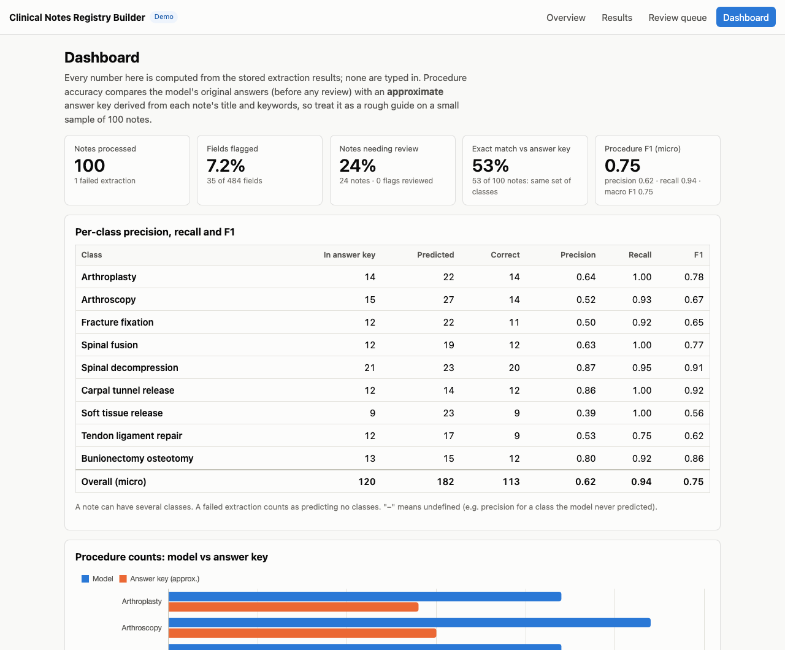

# Clinical Notes Registry Builder

Turns unstructured orthopedic operative notes into a structured research registry. A small open LLM
(Gemma 3 4B) reads each note and extracts the procedure(s), body part, laterality and patient age, each
with an evidence quote copied from the note. Answers that look doubtful are flagged for a person to
review, and the results can be exported as a spreadsheet or a REDCap import file.

**Live demo:** https://nairashwin9297.github.io/clinical-registry-builder/ (static; your review corrections
stay in your browser)

> A small portfolio demo built on public, de-identified sample notes. **Not a clinical product and not for
> clinical use.**



## What it does

1. **Overview**: the dataset, the four fields and the nine procedure classes.
2. **Results**: one row per note with the extracted values. Click a note to read it with each answer's
   evidence highlighted.
3. **Review queue**: only the flagged answers. Each shows the note excerpt, the AI's answer and why it was
   flagged; pick the correct value and save.
4. **Dashboard**: notes processed, share of fields flagged, match rate against the answer key, per-class
   precision/recall/F1, a chart of procedure counts, and CSV / REDCap exports.

## How it works

```
MTSamples CSV ──► scripts/prepare_data.py ──► data/notes.csv (100 notes + approximate answer key)
                                                   │
                         notebooks/extract.ipynb (Colab, Gemma 3 4B on a free GPU)
                                                   ▼
                                           data/results.json
                                                   │
                Django: import ─► flag ─► metrics ─► REST API ─► React UI (review, dashboard, export)
```

- **Data prep** (`scripts/prepare_data.py`): keeps orthopedic notes that have a PROCEDURE/OPERATION heading,
  drops discharge summaries and non-surgical procedures, cleans up the text, and labels each note with
  procedure classes derived from its title and keywords. That label is the **approximate answer key**.
  It picks 100 notes, balanced across classes, with a fixed random seed.
- **Extraction** (Colab notebook): the model must reply with JSON only, using exact class IDs and a short
  verbatim quote for every value. Malformed replies get one retry with the error explained; if that
  fails too, the note is recorded as a failure (and later lands in the review queue) instead of crashing
  the run. Progress is checkpointed every 10 notes.
- **Flagging**: an answer goes to the review queue when
  - its evidence quote isn't in the note (case, punctuation and spacing are ignored; a near-verbatim quote
    of 5+ words with one word changed still counts),
  - there is no quote,
  - the value isn't one of the allowed options,
  - it says "not mentioned" although the note seems to contain the answer (an age like "45-year-old", the
    words left/right/bilateral; a missing body part is always flagged), or
  - the whole extraction failed.
- **One shared implementation**: the prompt, validation, retry loop, quote matching and flag rules live in
  `backend/registry/extraction_core.py`. `scripts/build_notebook.py` copies that file into the notebook,
  and a test fails if the two drift apart, so Colab and the app's live mode behave identically.
- **Metrics** are computed from the stored results every time, never typed in. Accuracy scores the model's
  original answers; human corrections change the registry and exports, not the scores.

## Results

<!-- results:start (generated by `python manage.py readme_results --write ../README.md`) -->
Model: `google/gemma-3-4b-it`, prompt v3, on 100 notes. Procedure scores compare the model's answers with the **approximate** answer key.

| Measure | Result |
|---|---|
| Notes processed | 100 (1 failed extraction) |
| Fields flagged for review | 35 of 484 (7.2%) |
| Notes with at least one flag | 24 (24%) |
| Exact match (same set of procedure classes) | 53 of 100 (53%) |
| Procedure precision / recall / F1 (micro) | 0.62 / 0.94 / 0.75 |
| Procedure macro F1 | 0.75 |

| Procedure class | In answer key | Predicted | Precision | Recall | F1 |
|---|--:|--:|--:|--:|--:|
| Arthroplasty | 14 | 22 | 0.64 | 1.00 | 0.78 |
| Arthroscopy | 15 | 27 | 0.52 | 0.93 | 0.67 |
| Fracture fixation | 12 | 22 | 0.50 | 0.92 | 0.65 |
| Spinal fusion | 12 | 19 | 0.63 | 1.00 | 0.77 |
| Spinal decompression | 21 | 23 | 0.87 | 0.95 | 0.91 |
| Carpal tunnel release | 12 | 14 | 0.86 | 1.00 | 0.92 |
| Soft tissue release | 9 | 23 | 0.39 | 1.00 | 0.56 |
| Tendon ligament repair | 12 | 17 | 0.53 | 0.75 | 0.62 |
| Bunionectomy osteotomy | 13 | 15 | 0.80 | 0.92 | 0.86 |

Why fields were flagged:

- Evidence quote not found in the note: 26
- Extraction failed (whole note): 4
- Value outside allowed options: 2
- 'Not mentioned' but the note seems to contain it: 2
- No procedure class found: 1
<!-- results:end -->

The model catches nearly every answer-key procedure (high recall) but adds extra classes (lower precision).
Part of that may be the answer key's fault: it only lists what a note's title and keywords mention, so a
correct extra class still counts as a false positive. The extra predictions haven't been checked by hand,
so how much of the precision gap is model error is not known.

## Limitations

- **The answer key is approximate.** It comes from each note's title and keywords, not from expert
  annotation, and it only knows nine procedure classes.
- **Small sample.** 100 notes, one model, one prompt, one run. Treat the numbers as a rough guide.
- **Flags catch doubtful evidence, not every wrong answer.** A wrong class with a genuine quote isn't
  flagged. One failure mode the flags did catch: on some notes the model copied the prompt's worked
  example quote instead of quoting the note.
- **Laterality and age have no answer key**, so they are checked only by the flag rules, not scored.
- **Demo only.** Public sample transcriptions (MTSamples), no accounts, no security hardening for a public
  server. Not for clinical use.

## Run it locally

### With Docker (full app)

```bash
docker build -t registry-builder .
docker run --rm -p 8000:8000 registry-builder          # http://localhost:8000
```

The container imports `data/notes.csv` + `data/results.json` on first start. Add
`-v registry-data:/app/var` to keep your review corrections between runs.

### Development setup

Needs Python 3.11+ and Node 20+.

```bash
python3 -m venv venv
venv/bin/pip install -r backend/requirements-dev.txt
cd backend
../venv/bin/python manage.py migrate
../venv/bin/python manage.py import_results
../venv/bin/python manage.py runserver            # API on http://127.0.0.1:8000/api/

cd ../frontend
npm install
npm run dev                                       # UI on http://localhost:5173
```

### Live extraction with Ollama

Set `DEMO_MODE=false` to upload your own notes (CSV with a `transcription` column) and run extraction
on them locally, with the same prompt and rules as the notebook:

```bash
ollama pull gemma3:4b && ollama serve
DEMO_MODE=false ../venv/bin/python manage.py runserver
# Docker: docker run --rm -p 8000:8000 -e DEMO_MODE=false -e OLLAMA_URL=http://host.docker.internal:11434 registry-builder
```

| Variable | Default | Meaning |
|---|---|---|
| `DEMO_MODE` | `true` | `false` enables upload + live extraction |
| `OLLAMA_URL` / `OLLAMA_MODEL` | `http://localhost:11434` / `gemma3:4b` | Ollama server and model |
| `DEBUG` | `true` (`false` in Docker) | With `false`, `SECRET_KEY` must be set (Docker generates one) |
| `ALLOWED_HOSTS`, `SQLITE_PATH` | `localhost,127.0.0.1`, `backend/db.sqlite3` | Standard Django settings |

### Re-run the extraction in Colab

[](https://colab.research.google.com/github/nairashwin9297/clinical-registry-builder/blob/main/notebooks/extract.ipynb)

Use a T4 GPU runtime, accept the Gemma licence on Hugging Face, add your token as the Colab secret
`HF_TOKEN`, upload `data/notes.csv`, then run the "test on 5 notes" cell before the full run. Save the
downloaded `results.json` as `data/results.json`, re-import, and refresh this README's results with
`python manage.py readme_results --write ../README.md`.

### Static demo build (what GitHub Pages serves)

```bash
cd backend && ../venv/bin/python manage.py import_results && ../venv/bin/python manage.py export_static
cd ../frontend && npm run build:static              # output in frontend/dist
```

`.github/workflows/pages.yml` does this on every push to `main` and deploys to GitHub Pages.

### Tests

```bash
cd backend && ../venv/bin/pytest                    # backend: flagging, metrics, API, import, export
../venv/bin/pytest ../scripts                       # data prep
cd ../frontend && npm test                          # static demo logic matches the backend's CSV exports
```

GitHub Actions (`.github/workflows/ci.yml`) runs all three and builds the Docker image on every push.

## Project layout

```
data/         notes.csv (selected notes + answer key), results.json (Colab output)
scripts/      prepare_data.py (data prep), build_notebook.py (regenerates the notebook)
notebooks/    extract.ipynb (Colab extraction)
backend/      Django project: registry app (models, flagging, metrics, API, exports, commands)
frontend/     React + Vite + Chart.js
```

## Credits

- Notes: [MTSamples](https://mtsamples.com), a collection of de-identified sample medical transcriptions,
  via the Kaggle [Medical Transcriptions](https://www.kaggle.com/datasets/tboyle10/medicaltranscriptions)
  dataset. The raw CSV is not included in this repository.
- Model: [Gemma 3 4B (instruction-tuned)](https://huggingface.co/google/gemma-3-4b-it) by Google, used under
  the Gemma terms of use.
- Inspiration: Williamson A, Tavabi N, et al., Kiapour AM. "Large language models for zero-shot procedure
  extraction in orthopedic surgery: a comparative evaluation." *Scientific Reports*, 2026. Preprint:
  https://doi.org/10.1101/2025.08.19.25333995. This project only borrows the idea; its setup is much
  simpler (9 procedure classes instead of 74, an approximate answer key instead of expert labels, a small
  public sample), so its numbers are not comparable with the paper's.
